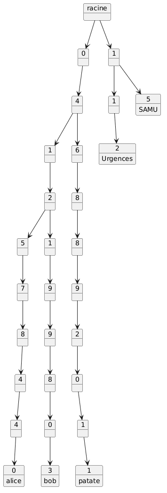

# phone-number-manager

Programme en Rust qui range un annuaire de numéros de téléphone dans un **trie** (arbre de préfixes), puis génère un graphe **PlantUML** (format MindMap) pour le visualiser.

Chaque chiffre d'un numéro est un nœud de l'arbre. Les numéros qui commencent pareil partagent la même branche, et le nom du contact est placé au bout de son numéro.



Fonctionne sous **Windows, macOS et Linux**.

## Prérequis

- **Rust** (édition 2024, donc Rust 1.85 ou plus récent), installé avec [rustup](https://www.rust-lang.org/tools/install) :
  - macOS / Linux : `curl --proto '=https' --tlsv1.2 -sSf https://sh.rustup.rs | sh`
  - Windows : télécharge et lance `rustup-init.exe` depuis [rustup.rs](https://rustup.rs)
- **PlantUML** (optionnel), pour transformer le fichier `.puml` en image. Voir [Générer l'image](#générer-limage).

Vérifie l'installation :

```bash
cargo --version
```

## Installation

```bash
git clone https://github.com/maknaeq/phone-number-manager.git
```

```bash
cd phone-number-manager
```

## Utilisation

Depuis la racine du projet (même commande sur tous les OS, dans un terminal, PowerShell ou l'invite de commandes) :

```bash
cargo run -- data/valid/common_prefix.json
```

Le `--` sépare les options de Cargo des arguments du programme. Le programme lit le fichier JSON, construit le trie et écrit le graphe dans `graph/<nom_du_fichier>.puml` :

```
graph écrit dans le fichier graph/common_prefix.puml
```

> Le programme écrit toujours dans le dossier `graph/`, qui doit exister. Lance-le donc depuis la racine du projet.

### Version compilée

```bash
cargo build --release
```

Puis lance l'exécutable :

| OS | Commande |
|---|---|
| macOS / Linux | `./target/release/phone-number-manager data/valid/common_prefix.json` |
| Windows (PowerShell) | `.\target\release\phone-number-manager.exe data\valid\common_prefix.json` |
| Windows (cmd) | `target\release\phone-number-manager.exe data\valid\common_prefix.json` |

## Générer l'image

**Option 1 : sans rien installer.** Copie le contenu du fichier `.puml` dans l'[éditeur en ligne de PlantUML](https://www.plantuml.com/plantuml/uml/).

**Option 2 : avec Docker, identique sur tous les OS.** Il faut [Docker](https://www.docker.com/products/docker-desktop/) :

```bash
docker pull plantuml/plantuml-server:jetty
```

```bash
docker run -d -p 8080:8080 plantuml/plantuml-server:jetty
```

Ouvre ensuite http://localhost:8080/ dans un navigateur et colle le contenu du fichier `.puml`.

**Option 3 : avec un gestionnaire de paquets.**

| OS | Installation |
|---|---|
| macOS | `brew install plantuml` |
| Linux (Debian / Ubuntu) | `sudo apt install plantuml` |
| Windows | `choco install plantuml` (avec [Chocolatey](https://chocolatey.org/)) |

Puis :

```bash
plantuml -tpng graph/common_prefix.puml
```

**Option 4 : avec le fichier `.jar`, identique sur tous les OS.** Il faut [Java](https://adoptium.net/) et [`plantuml.jar`](https://plantuml.com/fr/download) :

```bash
java -jar plantuml.jar -tpng graph/common_prefix.puml
```

L'image est créée à côté du fichier `.puml` (`graph/common_prefix.png`).

## Format d'entrée

Un tableau JSON de contacts, chacun avec un numéro (`nb`, en texte) et un nom (`name`) :

```json
[
  { "nb": "0412578440", "name": "Alice" },
  { "nb": "112", "name": "Urgences" },
  { "nb": "15", "name": "SAMU" }
]
```

Le fichier doit être encodé en UTF-8 (c'est le cas par défaut dans VS Code).

## Format de sortie

Un MindMap PlantUML avec une étoile `*` par niveau de profondeur : `*` pour le premier chiffre, `**` pour le deuxième, etc. Le nom du contact est placé un niveau sous son dernier chiffre.

## Fichiers de contacts

Les fichiers d'exemple sont rangés dans deux dossiers :

```
data/
├── valid/     # fichiers que le programme accepte
└── invalid/   # fichiers qui provoquent une erreur, ou des numéros incorrects
```

### Fichiers valides (`data/valid/`)

Chaque fichier montre une forme différente de trie.

#### `short_numbers.json` : numéros courts qui partagent le même premier chiffre

```json
[
  { "nb": "112", "name": "Urgences" },
  { "nb": "15", "name": "SAMU" },
  { "nb": "17", "name": "Police" },
  { "nb": "18", "name": "Pompiers" }
]
```

Les quatre numéros commencent par `1`, donc ils partagent une seule racine :

```
@startmindmap
* 1
** 1
*** 2
**** Urgences
** 5
*** SAMU
** 7
*** Police
** 8
*** Pompiers
@endmindmap
```

#### `prefix_of_other.json` : un numéro qui est le début d'un autre

```json
[
  { "nb": "112", "name": "Urgences" },
  { "nb": "1123", "name": "Standard" }
]
```

`Urgences` est au milieu de la branche, et la branche continue vers `Standard` :

```
@startmindmap
* 1
** 1
*** 2
**** Urgences
**** 3
***** Standard
@endmindmap
```

#### `prefix_chain.json` : un nom à chaque niveau

```json
[
  { "nb": "1", "name": "Un" },
  { "nb": "12", "name": "Douze" },
  { "nb": "123", "name": "Cent vingt-trois" },
  { "nb": "1234", "name": "Mille deux cent trente-quatre" }
]
```

Chaque numéro est le début du suivant, donc chaque niveau porte un nom :

```
@startmindmap
* 1
** Un
** 2
*** Douze
*** 3
**** Cent vingt-trois
**** 4
***** Mille deux cent trente-quatre
@endmindmap
```

#### `duplicate.json` : le même numéro deux fois

```json
[
  { "nb": "0412578440", "name": "Alice" },
  { "nb": "0412578440", "name": "Bob" }
]
```

Le dernier nom remplace le premier, donc seul `Bob` reste :

```
@startmindmap
* 0
** 4
*** 1
**** 2
***** 5
****** 7
******* 8
******** 4
********* 4
********** 0
*********** Bob
@endmindmap
```

#### `same_area_code.json` : numéros de portable qui partagent un long préfixe

```json
[
  { "nb": "0612345678", "name": "Alice" },
  { "nb": "0612345699", "name": "Bob" },
  { "nb": "0612340000", "name": "Chloé" },
  { "nb": "0698765432", "name": "David" }
]
```

Alice et Bob partagent `06123456` et se séparent au 9ᵉ chiffre. Chloé se sépare après `061234`, et David dès le 3ᵉ chiffre.

<details>
<summary>Voir le PlantUML généré</summary>

```
@startmindmap
* 0
** 6
*** 1
**** 2
***** 3
****** 4
******* 5
******** 6
********* 7
********** 8
*********** Alice
********* 9
********** 9
*********** Bob
******* 0
******** 0
********* 0
********** 0
*********** Chloé
*** 9
**** 8
***** 7
****** 6
******* 5
******** 4
********* 3
********** 2
*********** David
@endmindmap
```

</details>

#### `no_common_prefix.json` : aucun préfixe commun

```json
[
  { "nb": "0612345678", "name": "Alice" },
  { "nb": "112", "name": "Urgences" },
  { "nb": "3949", "name": "Pole Emploi" }
]
```

Chaque numéro commence par un chiffre différent, donc le trie a trois racines (`0`, `1` et `3`) et aucune branche partagée.

<details>
<summary>Voir le PlantUML généré</summary>

```
@startmindmap
* 0
** 6
*** 1
**** 2
***** 3
****** 4
******* 5
******** 6
********* 7
********** 8
*********** Alice
* 1
** 1
*** 2
**** Urgences
* 3
** 9
*** 4
**** 9
***** Pole Emploi
@endmindmap
```

</details>

#### `phonebook.json` : un annuaire complet

Fixes (`01`, `04`), portables (`06`, `07`) et numéros d'urgence (`1x`) mélangés : 10 contacts, 2 racines.

<details>
<summary>Voir le PlantUML généré</summary>

```
@startmindmap
* 0
** 1
*** 4
**** 5
***** 6
****** 7
******* 8
******** 9
********* 0
********** 1
*********** Bureau Paris
********** 2
*********** Accueil Paris
** 4
*** 7
**** 8
***** 1
****** 2
******* 3
******** 4
********* 5
********** 6
*********** Bureau Lyon
** 6
*** 1
**** 2
***** 3
****** 4
******* 5
******** 6
********* 7
********** 8
*********** Alice
*** 8
**** 7
***** 6
****** 5
******* 4
******** 3
********* 2
********** 1
*********** Bob
** 7
*** 1
**** 1
***** 2
****** 2
******* 3
******** 3
********* 4
********** 4
*********** Chloé
* 1
** 1
*** 2
**** Urgences
** 5
*** SAMU
** 7
*** Police
** 8
*** Pompiers
@endmindmap
```

</details>

#### Autres fichiers valides

| Fichier | Cas testé |
|---|---|
| `single.json` | Un seul contact : une seule branche |
| `common_prefix.json` | Numéros en `04` et numéros d'urgence en `1` (c'est l'image en haut de ce README) |
| `empty.json` | Liste vide : le graphe ne contient que `@startmindmap` et `@endmindmap` |

### Fichiers invalides (`data/invalid/`)

| Fichier | Problème | Résultat |
|---|---|---|
| `trailing_comma.json` | Virgule en trop après le dernier contact | `Erreur en lisant … : trailing comma at line 3 column 1` |
| `missing_field.json` | Contact sans `name` | ``Erreur en lisant … : missing field `name` `` |
| `wrong_type.json` | `nb` écrit comme un nombre au lieu d'un texte | `Erreur en lisant … : invalid type: integer …, expected a string` |
| `not_an_array.json` | Un seul objet au lieu d'un tableau | `Erreur en lisant … : invalid type: map, expected a sequence` |
| `bad_numbers.json` | Numéro avec des lettres et numéro vide | `Erreur en lisant … : numéro invalide "04AB578440" pour Lettres (le numéro doit contenir uniquement des chiffres)` |

En cas d'erreur, le programme affiche le message et s'arrête avec le code de sortie `1`, sans écrire de graphe. Un fichier qui n'existe pas donne aussi une erreur.

Un numéro est valide s'il n'est pas vide et ne contient que des chiffres : pas de lettres, d'espaces ni de préfixe international (`+33`), comme le demande le sujet.

## Tests

```bash
cargo test
```

Les tests se trouvent dans `src/lib.rs` et couvrent le trie, la lecture du JSON et la génération PlantUML.

## Structure du projet

```
src/
├── main.rs   # Point d'entrée : lit les arguments, enchaîne lecture → trie → PlantUML
└── lib.rs    # Trie, lecture des contacts (serde_json) et génération PlantUML
data/
├── valid/    # Fichiers de contacts acceptés
└── invalid/  # Fichiers de contacts en erreur
graph/        # Fichiers .puml générés (un par fichier de data/valid/)
```

Pour régénérer tous les graphes :

```bash
cargo run -- data/valid/single.json
```

Répète la commande pour chaque fichier de `data/valid/`. Chaque fichier `data/valid/<nom>.json` donne `graph/<nom>.puml`.

## Auteurs

- Quentin : gestion des erreurs et lecture du JSON
- Kaan : le trie
- Timothé : la génération PlantUML
